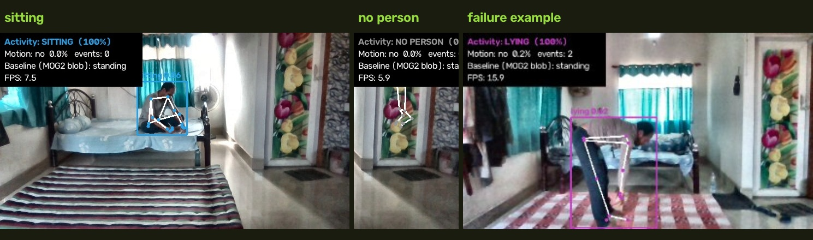

# Real-Time and Video-Based Motion Detection and Activity Monitoring

CSST 106 Computer Vision final project · Laguna State Polytechnic University  
**Porcopio Zheniel Ivan · Veridiano Wilmark** · tag **`v1.0`**

Detects a person in a laptop webcam, phone video or recorded file and classifies **standing, sitting,
walking, running or lying**. Pretrained YOLO11n + MediaPipe Pose + geometric rules tuned on validation
data — nothing trained by us. Gradio app for video / photo / live webcam.



**Main result (held-out test, 90 segments):** macro-F1 **0.772** · accuracy **0.756** · **15.1 FPS** on
i7-6700HQ CPU · fixed-room camera **93%** · vs MOG2 baseline macro-F1 **0.081**.

```
frame ─► preprocess() ─► infer() ─────────────────────────────► postprocess() ─────────────────► render()
         resize ≤640     ├ MOG2 background subtraction ──► blob shape + speed ─► BASELINE rules ┐  boxes, skeleton,
         CLAHE (Lab L)   ├ YOLO11n person boxes                                                  ├► label, FPS,
         gray + blur     ├ MediaPipe Pose, 33 landmarks ─► angles, thigh ratio, torso tilt,      │  CSV row
                         └ LK optical flow (background) ─► hip speed minus camera motion, leg    │
                                                           swing ─► MAIN rules ─► smoothing +   ─┘
                                                           persistence
```

## Requirements

- Windows / macOS / Linux, **Python 3.10–3.13**, CPU only (no GPU required)
- ~200 MB disk for deps + models (videos optional; not needed to reproduce metrics)

## Installation

```bash
python -m venv .venv
.venv\Scripts\activate            # macOS/Linux: source .venv/bin/activate
pip install -r requirements.txt
```

The first run downloads two model files into `models/`: MediaPipe pose lite (~6 MB) and YOLO11n (~6 MB).
Weights are also suitable to attach on the GitHub `v1.0` release.

## How to run CareView (default)

```bash
python app.py
```

`http://127.0.0.1:7860/` opens the **Caregiver Home** (`/caregiver`) — not the old activity-lab UI.

| Who | URL | What |
|---|---|---|
| **Phone / caregiver** | `http://<laptop-lan-ip>:7860/caregiver` | Patients, alerts, History, live feed view |
| **Laptop camera** | `http://127.0.0.1:7860/camera-station` | Start webcam for **Alex** (live patient) |
| Chooser page | `http://127.0.0.1:7860/start` | Pick caregiver / camera / lab |
| Old CV lab | `http://127.0.0.1:7860/lab` | Video / photo activity analysis (optional) |

**Demo login:** `caregiver` / `care123`  
**Demo patients (auto-seeded on first run):** **Alex** (live cam) + **Casey** (ready fall alerts + playback)

### Laptop + phone test (same Wi‑Fi)

1. On the laptop: `python app.py`
2. Phone browser: `http://<laptop-ip>:7860/caregiver` → CareView Home
3. Laptop browser: `http://127.0.0.1:7860/camera-station` → **Start Monitoring** for Alex
4. Phone: open **Alex** to see the live feed; open **Casey** / **Alerts** for the ready fall demo

First boot may take ~1 minute while Casey’s fall clip is prepared. Settings → **Reset demo** reloads Alex + Casey.

Models load **once** at start-up. CLI / offline eval still work:

```bash
python src/run.py --webcam 0
python src/run.py --input path/to/video.mp4 --output outputs/demo/
python src/run.py --input photo.jpg --output outputs/
```

## Reproduce the results table

```bash
python src/evaluate.py --split test
```

Works on a **fresh clone without the videos**: per-frame features are in `outputs/cache/` (~14 MB). Numbers
match `docs/results_test.md` and `docs/final_report.md`. With videos present, `--rerun` rebuilds the cache.
Tuning seed: `--seed 106`.

## Dataset and weights

| Item | Where |
|---|---|
| Split lists / annotations | `data/splits.csv`, `data/annotations/` (committed) |
| Videos (~3 GB) | Not in git — `python scripts/get_data.py --root D:/datasets` |
| YOLO + pose weights | `models/` (auto-download) or release assets |
| Tuned thresholds | `configs/tuned_params.json` |

See [data/README.md](data/README.md).

## Project structure

```
app.py          Gradio browser UI
src/            pipeline, YOLO, pose, rules, evaluate.py, run.py
scripts/        data import, tune, test cases, slides, PDF helpers
configs/        tuned_params.json (+ M3 comparison file)
tests/          test_cases.csv + cases/
docs/           final_report.md/.pdf · slides_final.pptx/.pdf · backup_demo_m4.mp4 · figures/
outputs/final/  screenshots and sample outputs for the report
outputs/cache/  features that make evaluate.py reproducible offline
```

## Deliverables (Milestone 5)

| File | What |
|---|---|
| [docs/Final_Report_v1.0.pdf](docs/Final_Report_v1.0.pdf) / [docs/final_report.pdf](docs/final_report.pdf) | Final report |
| [docs/slides_final.pptx](docs/slides_final.pptx) | Presentation slides (PDF next to it if present) |
| [docs/backup_demo_m4.mp4](docs/backup_demo_m4.mp4) | ≤5 min backup demo reel |
| [outputs/final/](outputs/final/) | Sample outputs / screenshots |

## Team and contributions

| Member | Focus |
|---|---|
| Veridiano Wilmark | Pipeline core, eval/tune, Gradio app, reproducibility |
| Porcopio Zheniel Ivan | Detection/pose, dataset splits, test cases & backup demo, report, slides, live demo |

Details: Appendix C of the final report and `docs/remaining.md`.
