# Error analysis and improvement plan (Milestone 3)

Test split, main method (pose + rules, tuned on val, camera compensation on): **59 of 90 segments correct,
31 failures**. Numbers come from `python src/evaluate.py --split test`. The gallery and the counts below are
regenerated by `python scripts/failure_gallery.py`.

## Reading the confusion matrix

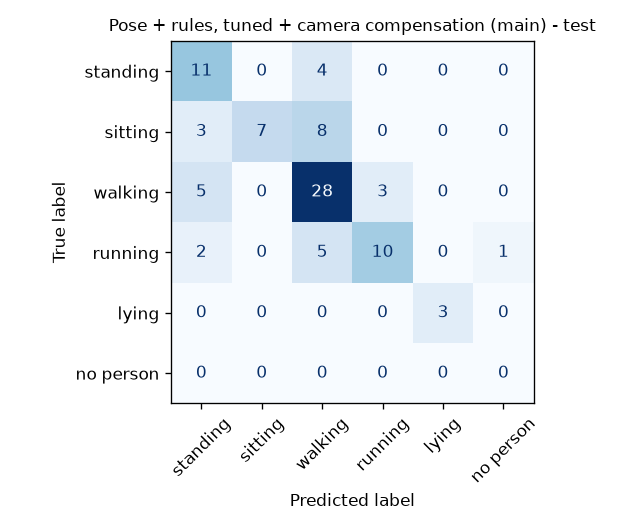

- The largest off-diagonal cell is **sitting → walking (8)**, plus sitting → standing (3). Sitting recall is only
  **0.39**, while its precision is 1.00. When we say "sitting" we are right, but we miss most sitting.
- **running → walking (5)** and **walking → standing (5)** are the speed boundaries. They are mostly movie clips
  where the camera moves or the runner is small.
- **standing → walking (4)**: someone standing but moving their arms or turning.
- `lying` scores 1.00, but on only **3** test segments (and 3 in val), so that number says very little.

## What the failures have in common

| Condition | Segments | Correct (main) |
|---|---:|---:|
| GMDCSA24 room, day | 30 | 22 (73%) |
| GMDCSA24 room, **night** | 15 | 7 (47%) |
| HMDB51 movie, static camera | 13 | 8 (62%) |
| HMDB51 movie, **moving camera** | 32 | 22 (69%) |

Night looks like the worst condition, but **darkness is not the cause**. The pose was found in 70–100% of the
frames of every failed night segment. The 8 night failures are 4 × cause 1 below (seated, talking or reading),
2 × sitting called standing, and 2 × short transitions.

**Tuning helped the movie clips and hurt the room clips.** The same 90 test segments, scored with each parameter
set:

| Test subset | M2 hand-set values | Tuned main | Baseline |
|---|---:|---:|---:|
| HMDB51, moving camera (32) | 15 | **22** | 1 |
| HMDB51, static camera (13) | 3 | **8** | 0 |
| GMDCSA24 room (45) | **36** | 29 | 17 |

Overall, the tuned version wins (macro-F1 0.702 vs 0.623), but all of the gain is on movie clips. The lower walking
thresholds that rescue movie walkers also turn seated people in the room into walkers (cause 1). Camera
compensation itself adds little: on val, switching it off changes only 1 of 108 segments (1 of 21 moving-camera
segments). Most of the movie gain comes from the re-tuned speed thresholds, not from the optical flow.

## Cause 1, the biggest group: limb motion in place read as walking (11 of 31)

T001, T003, T012, T017, T021, T024, T026, T027 (sitting → walking) and T009, T015, T037 (standing → walking).
All are GMDCSA24 with a static camera, and the pose was found in nearly every frame. The person is writing,
drinking, reading, talking, exercising their arms, or closing a curtain. Measured on T024, T026 and T001:

| | knee | hip angle | thigh ratio | hip speed | **leg swing** | rule needs |
|---|---:|---:|---:|---:|---:|---|
| T024 seated, talking | 98° | 120° | 0.31 | 0.01 | **0.40** | sitting needs hip < 106°, slow needs leg < 0.354 |
| T026 seated, talking | 116° | 126° | 0.34 | 0.01 | **0.51** | |
| T001 seated, writing | 86° | 100° | 0.05 | 0.01 | **0.43** | |

**Mechanism:** the body does not travel (hip speed 0.01), but small foot and leg movements, plus landmark jitter,
give a *leg swing* of 0.40–0.51 body-heights/s. The tuned walking threshold is 0.354, so the frame is "not slow",
the sitting rule (which requires slow) never fires, and the leg-swing rule calls it walking. Tuning made this
worse: val had 55 walking segments but only 15 sitting, so lowering the walking threshold won more val segments
than it lost. The tuned hip-angle limit (106°) is also stricter than these seated poses (100–126°).

## Plan: top 3 changes, each tied to a counted cause

| Failure cause (count) | Change | Expected effect / how measured |
|---|---|---|
| **Limb motion in place read as walking (11 of 31)** | 1) Check the seated posture **before** speed, so leg swing cannot override a folded leg. 2) Walking by leg swing needs the two ankles to move in **opposite directions** (a real stride), not both jittering. 3) Re-tune with an objective that weights each **dataset** equally, not only each class, so movie walkers cannot outvote room sitters, and with more sitting segments in val (our own recordings). | Sitting recall 0.39 → ≥ 0.7, standing → walking errors halved, and room-clip accuracy back to at least the M2 level (36 of 45) without losing the movie gain. Measured on val per class and per dataset, then once on test at the final check. |
| **Moving camera (6), person not found (3), far/low res (1): 10 of 31, all HMDB** | 1) The current median-shift compensation barely changes results (1 val segment), so replace it with a **RANSAC homography** (`cv2.findHomography`), which also handles zoom and fast pans, and check its estimate on the 6 failing clips. 2) When the person is < 120 px tall, run pose on the **YOLO crop, upscaled** to 256 px. | Pose found ≥ 90% on HMDB test clips (now 3 clips < 50%). Running recall 0.56 → ≥ 0.7. Measured per clip in the test log (`pose_found`, recall). |
| **Transitions / short segments (3) and speed near a threshold (3)** | Score segments without the 0.5 s around each label change (the speed window spans the boundary). For running vs walking, add stride frequency (ankle crossings per second), which separates the two better than speed when the camera moves. | Transition errors → 0. Walking/running confusion (8 cells) halved on val. |

Not in the top 3, but on the list: **lying** has only 3 val and 3 test segments, so its threshold (77°) is tuned
on almost nothing. We will label the lying-on-the-floor part at the end of the GMDCSA24 fall videos (unlabelled
now) and record our own lying clips, before trusting any lying number.

## Failure gallery

**Checked by eye** (all 31 frames): the suggested causes match what the frames show. Notes:

- T041 and T042: sitting on the **edge of the bed, filmed from the front**. The thighs point down towards the
  camera, so in 2D the legs look straight, which is the "look-alike posture" case the thigh-ratio rule was meant to
  catch. Here the thigh ratio stays above the tuned limit (0.24).
- T012: the segment is labelled sitting while the person is on the floor getting ready to lie down. The pose is
  correct, and this is partly a label-boundary case.
- T054, T057, T084: night, motion blur and a rain scene in movies, with no usable pose.
- T060: the legs are hidden behind a bin (cut off).
- On low-resolution movie frames the text panel covers part of the person (T055, T071). This is display only and
  does not affect the label.

<!-- GALLERY START -->

**31 failures out of 90 test segments** (main method). Causes are suggested by `scripts/failure_gallery.py` from measured signals, then checked by looking at each frame.

| Cause | Count |
|---|---:|
| Limb motion in place read as walking | 11 |
| Moving camera | 6 |
| Transition / short segment | 3 |
| Speed near a threshold | 3 |
| Person not found | 3 |
| Look-alike posture | 2 |
| Cut off by the frame | 2 |
| Far away / low resolution | 1 |

Most common confusions (expected → got): sitting → walking (8), running → walking (5), walking → standing (5), standing → walking (4), sitting → standing (3), walking → running (3).

| ID | Frame | Input | Expected | Got | Cause | Measured | Condition |
|---|---|---|---|---|---|---|---|
| T001 | 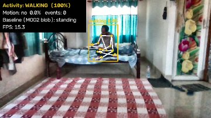 | _segments/gmdcsa-s3__adl-01.mp4 [0-8s] | sitting | walking | Limb motion in place read as walking | pose 100%, legs 100%, 62 px tall, camera 0 px/s, 8.0 s | room, static camera; Day; Full T-shirt & Trousers; Writing s |
| T003 | 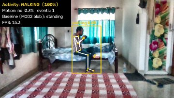 | _segments/gmdcsa-s3__adl-03.mp4 [3-7.4s] | sitting | walking | Limb motion in place read as walking | pose 100%, legs 100%, 109 px tall, camera 0 px/s, 4.4 s | room, static camera; Day; Full T-shirt & Trousers; Getting u |
| T009 | 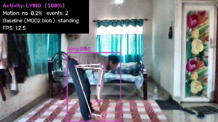 | _segments/gmdcsa-s3__adl-05.mp4 [0-5s] | standing | walking | Limb motion in place read as walking | pose 100%, legs 100%, 239 px tall, camera 0 px/s, 5.0 s | room, static camera; Day; Full T-shirt & Trousers; Exercisin |
| T012 | 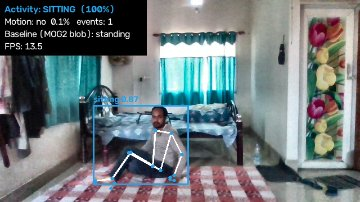 | _segments/gmdcsa-s3__adl-09.mp4 [2.5-6s] | sitting | walking | Limb motion in place read as walking | pose 100%, legs 100%, 127 px tall, camera 0 px/s, 3.5 s | room, static camera; Day; Full T-shirt & Trousers; Sleeping  |
| T015 | 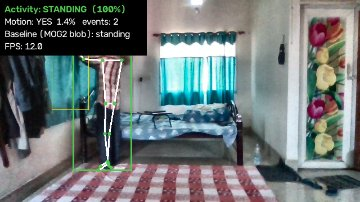 | _segments/gmdcsa-s3__adl-11.mp4 [2.7-12s] | standing | walking | Limb motion in place read as walking | pose 100%, legs 100%, 181 px tall, camera 0 px/s, 9.3 s | room, static camera; Day; Full shirt & Trousers; Closing the |
| T017 | 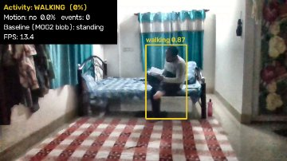 | _segments/gmdcsa-s3__adl-12.mp4 [0.8-8.1s] | sitting | walking | Limb motion in place read as walking | pose 70%, legs 100%, 109 px tall, camera 0 px/s, 7.3 s | room, static camera; Night; Full T-shirt 2 & Trousers; Chang |
| T018 | 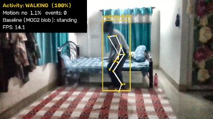 | _segments/gmdcsa-s3__adl-12.mp4 [8.1-9.2s] | standing | walking | Transition / short segment | pose 100%, legs 100%, 160 px tall, camera 0 px/s, 1.1 s | room, static camera; Night; Full T-shirt 2 & Trousers; Chang |
| T021 | 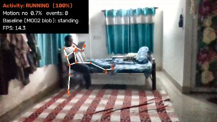 | _segments/gmdcsa-s3__adl-15.mp4 [0-7s] | sitting | walking | Limb motion in place read as walking | pose 100%, legs 100%, 119 px tall, camera 0 px/s, 7.1 s | room, static camera; Night; Full T-shirt (different) & Trous |
| T023 | 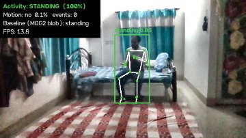 | _segments/gmdcsa-s3__adl-17.mp4 [0-12s] | sitting | standing | Look-alike posture | pose 100%, legs 100%, 123 px tall, camera 0 px/s, 12.1 s | room, static camera; Night; Full T-shirt (different) & Trous |
| T024 | 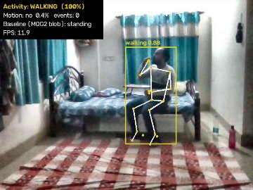 | _segments/gmdcsa-s3__adl-18.mp4 [0.6-11s] | sitting | walking | Limb motion in place read as walking | pose 99%, legs 100%, 162 px tall, camera 0 px/s, 10.4 s | room, static camera; Night; Full T-shirt (different) & Trous |
| T026 | 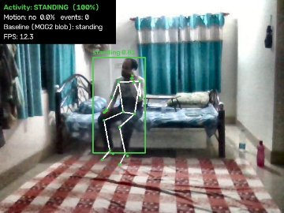 | _segments/gmdcsa-s3__adl-20.mp4 [0-9s] | sitting | walking | Limb motion in place read as walking | pose 100%, legs 100%, 161 px tall, camera 0 px/s, 9.1 s | room, static camera; Night; Full T-shirt (different) & Trous |
| T027 | 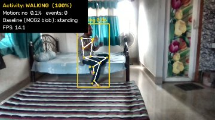 | _segments/gmdcsa-s3__adl-21.mp4 [0-10s] | sitting | walking | Limb motion in place read as walking | pose 100%, legs 100%, 111 px tall, camera 0 px/s, 10.0 s | room, static camera; Day; Kurta & Trousers; Drinking while s |
| T031 | 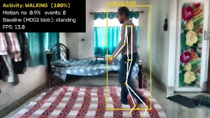 | _segments/gmdcsa-s3__fall-04.mp4 [0-1.2s] | walking | running | Transition / short segment | pose 100%, legs 100%, 244 px tall, camera 0 px/s, 1.2 s | room, static camera; Day; Full T-shirt & Trouser; Walking an |
| T037 | 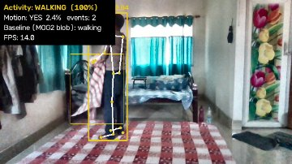 | _segments/gmdcsa-s3__fall-14.mp4 [4.6-8.1s] | standing | walking | Limb motion in place read as walking | pose 100%, legs 100%, 209 px tall, camera 0 px/s, 3.5 s | room, static camera; Day; Full T-shirt; Shirt  & Trouser; Fa |
| T041 | 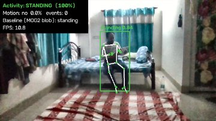 | _segments/gmdcsa-s3__fall-17.mp4 [0-1.4s] | sitting | standing | Transition / short segment | pose 91%, legs 100%, 127 px tall, camera 0 px/s, 1.5 s | room, static camera; Night; Full T-shirt (different) & Trous |
| T042 | 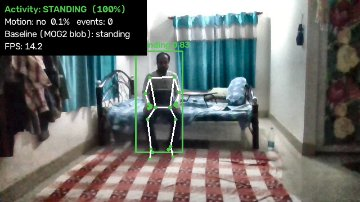 | _segments/gmdcsa-s3__fall-18.mp4 [0-3.2s] | sitting | standing | Look-alike posture | pose 100%, legs 100%, 121 px tall, camera 0 px/s, 3.2 s | room, static camera; Night; Full T-shirt (different) & Trous |
| T046 | 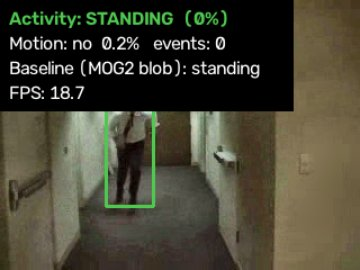 | running/hmdb-20060723sfjffsomelikeitwarmed__01.avi | running | standing | Speed near a threshold | pose 50%, legs 100%, 139 px tall, camera 9 px/s, 1.9 s | movie; static camera; front view; med quality |
| T047 | 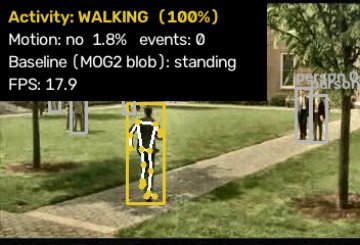 | running/hmdb-a-beautiful-mind-4__01.avi | running | walking | Moving camera | pose 92%, legs 100%, 62 px tall, camera 2 px/s, 3.5 s | movie; moving camera; back view; med quality |
| T054 | 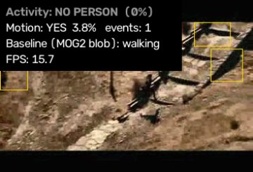 | running/hmdb-return-of-the-king-4__01.avi | running | no person | Person not found | pose 0%, legs 0%, 0 px tall, camera 106 px/s, 4.0 s | movie; moving camera; right view; med quality |
| T055 | 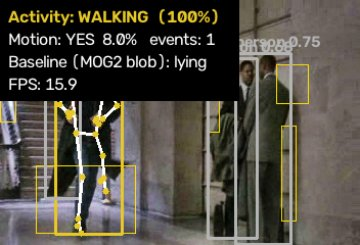 | running/hmdb-the-fugitive-5__01.avi | running | walking | Moving camera | pose 99%, legs 72%, 136 px tall, camera 79 px/s, 2.8 s | movie; moving camera; front view; med quality |
| T056 | 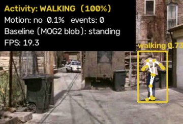 | running/hmdb-the-fugitive-5__02.avi | running | walking | Far away / low resolution | pose 63%, legs 100%, 79 px tall, camera 13 px/s, 2.4 s | movie; static camera; back view; med quality |
| T057 | 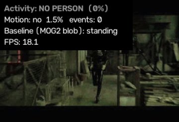 | running/hmdb-the-matrix-1__01.avi | running | standing | Person not found | pose 23%, legs 100%, 84 px tall, camera 32 px/s, 1.7 s | movie; moving camera; front view; med quality |
| T060 | 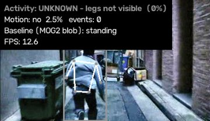 | running/hmdb-the-protector__01.avi | running | walking | Cut off by the frame | pose 91%, legs 43%, 129 px tall, camera 4 px/s, 0.8 s | movie; moving camera; back view; med quality |
| T063 | 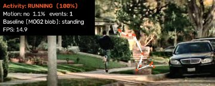 | running/hmdb-veoh-alpha-dog-1__01.avi | running | walking | Moving camera | pose 76%, legs 89%, 141 px tall, camera 67 px/s, 3.3 s | movie; moving camera; back view; med quality |
| T071 | 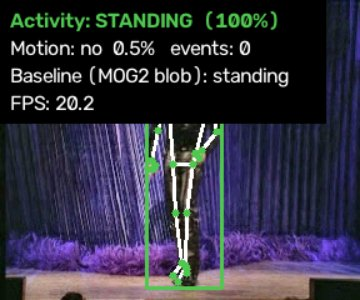 | walking/hmdb-eddieizzardcircle__01.avi | walking | standing | Speed near a threshold | pose 100%, legs 100%, 134 px tall, camera 0 px/s, 2.5 s | movie; static camera; left view; med quality |
| T073 | 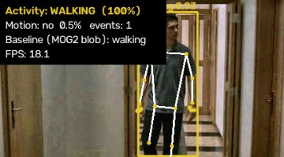 | walking/hmdb-eurotrip__02.avi | walking | standing | Speed near a threshold | pose 99%, legs 68%, 209 px tall, camera 7 px/s, 3.5 s | movie; static camera; front view; med quality |
| T077 | 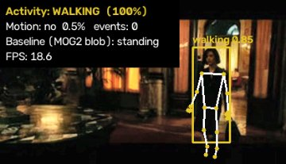 | walking/hmdb-oceans12__01.avi | walking | standing | Moving camera | pose 91%, legs 77%, 129 px tall, camera 6 px/s, 1.8 s | movie; moving camera; front view; med quality |
| T078 | 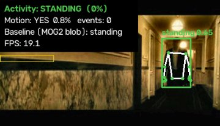 | walking/hmdb-oceans12__02.avi | walking | standing | Cut off by the frame | pose 88%, legs 15%, 115 px tall, camera 0 px/s, 3.3 s | movie; moving camera; front view; med quality |
| T081 | 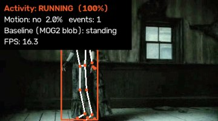 | walking/hmdb-sweeneytodd__02.avi | walking | running | Moving camera | pose 70%, legs 100%, 159 px tall, camera 28 px/s, 1.8 s | movie; moving camera; left view; med quality |
| T084 | 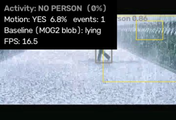 | walking/hmdb-the-matrix-revolutions-5__01.avi | walking | standing | Person not found | pose 2%, legs 100%, 46 px tall, camera 51 px/s, 5.5 s | movie; static camera; left view; med quality |
| T087 | 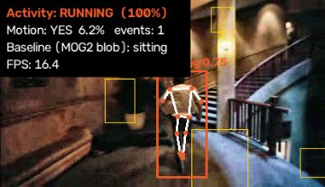 | walking/hmdb-the-protector__03.avi | walking | running | Moving camera | pose 92%, legs 100%, 113 px tall, camera 97 px/s, 1.6 s | movie; moving camera; right view; med quality |

<!-- GALLERY END -->
