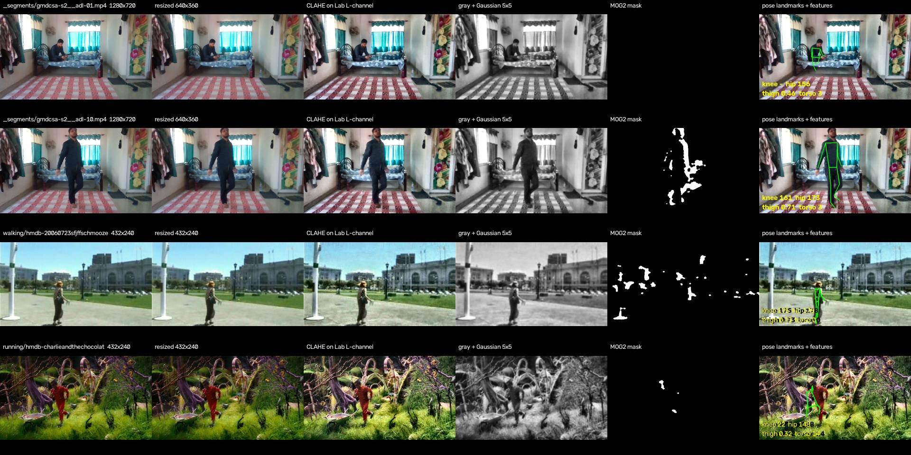
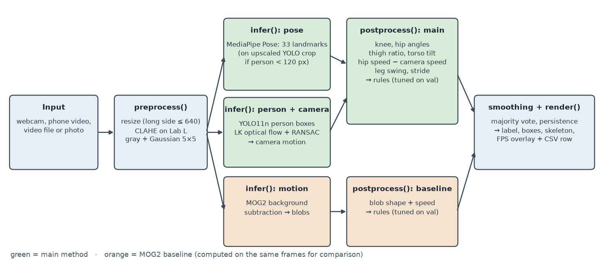
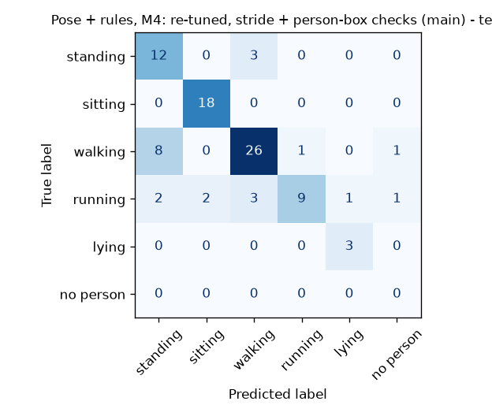
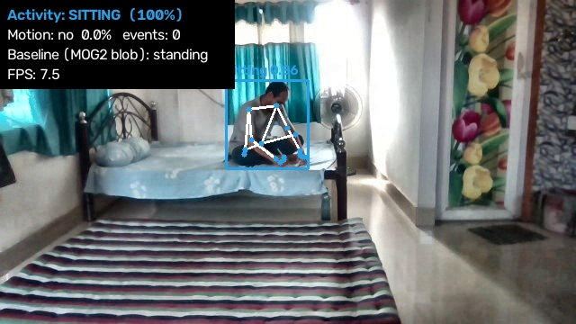
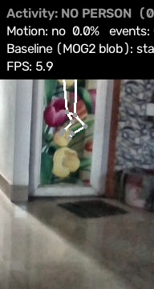
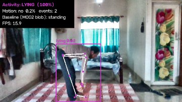
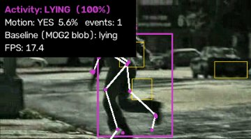

# Real-Time and Video-Based Motion Detection and Activity Monitoring System Using Computer Vision

**Final report (Milestone 5).** 
Porcopio Zheniel Ivan · Veridiano Wilmark — CSST 106 Computer Vision, Jeremy C. Reyes 
Laguna State Polytechnic University · Repository: https://github.com/Wilul1/Computer_Vision (tag `v1.0`)

## Abstract

Monitoring people for safety or behaviour analysis is still mostly manual: a watcher gets tired, and recorded
footage takes a long time to review. We built a laptop system that takes a webcam, phone video or recorded file,
finds the person, and classifies **standing, sitting, walking, running or lying** in real time. The pipeline uses
pretrained **YOLO11n** and **MediaPipe Pose**, camera-motion compensation, and **rule-based** geometry tuned on a
held-out validation split — nothing is trained by us. On 90 locked test segments the main method reaches
**macro-F1 0.772** and **accuracy 0.756**, versus **0.081 / 0.178** for a MOG2-blob baseline, at **15.1 FPS** on an
i7-6700HQ CPU. It is reliable on a fixed room camera (93%) and much weaker on moving-camera movie clips (58%). A
Gradio app exposes video, photo and live webcam modes. Falls / sudden abnormal motion remain future work.

## 1. Introduction

Watching people for safety, security or behaviour analysis is still mostly done by hand. A person watching a live
feed gets tired and misses events, and reviewing recorded footage is slow. Automatic motion detectors exist, but
they usually need special hardware, and they only say *that* something moved. A passing shadow or a pet triggers
them as easily as a person, and they cannot say what the person is doing.

This project targets ordinary cameras (laptop webcam, phone, recorded video) and answers **what the person is
doing**. Intended users are small teams who need a simple activity log without CCTV infrastructure: home or lab
monitoring, classroom demos, and lightweight behaviour review.

### Objectives (measurable)

| # | Objective | Target | Status |
|---|---|---|---|
| 1 | Accept live camera and recorded video/photo | Working app + CLI | Met (`app.py`, `src/run.py`) |
| 2 | Detect people and track motion | YOLO + pose + MOG2 | Met |
| 3 | Classify standing / sitting / walking / running / lying | Macro-F1 ≫ baseline on locked test | Met (0.772 vs 0.081) |
| 4 | Interface with boxes and activity labels | Browser + OpenCV window | Met |
| 5 | Evaluate accuracy, speed, lighting | Day/night breakdown + FPS | Met on public data |
| 6 | Sudden abnormal movement (falls) | Detect fall → lying | **Not met** (future work) |

## 2. Related work

| Approach | Idea | Relation to ours |
|---|---|---|
| Classical background subtraction (MOG / MOG2) | Learn background; flag moving pixels | Our **baseline** only; cannot tell sitting from standing when the person is still |
| Pose estimators (OpenPose, MediaPipe Pose) | 2D/3D joints from RGB | We use MediaPipe lite joints as features, not as the final classifier |
| Action recognition CNNs / transformers (e.g. on Kinetics, HMDB) | End-to-end video classifiers | Need large labelled sets and GPUs; we stay CPU-only with explainable rules |
| YOLO person detection | Fast bounding boxes | We use YOLO11n to find the subject and to gate false poses |
| Fall-detection datasets (e.g. GMDCSA24) | Falls and ADLs in rooms | We reuse ADL segments for posture/activity; fall logic is not implemented yet |

Our design is a **hybrid**: pretrained detectors for perception, hand-written geometric rules for activity, and
validation-only threshold tuning. That trades peak accuracy on wild movie footage for speed, explainability and a
small dependency footprint.

## 3. Dataset

| | GMDCSA24 | HMDB51 |
|---|---|---|
| What | One room, **fixed camera**, 4 people, day / night / lights off, 1280×720 | Movie and web clips, **often a moving camera**, ~240 px tall |
| Classes used | sitting, standing, walking, lying (author time segments) | walk, run |
| Licence | MIT | Non-commercial research |
| Split unit | Subject | Movie |

The split is by **source**, so a person or movie never appears in two splits. GMDCSA24: 2 subjects train, 1 val, 1
test (day+night subject chosen for test **before** any test metrics). Ground truth is labelled **segments** (≥ 1 s).
Counts: **train 280, val 108, test 90**. Full data card: `data/README.md`.

Nothing is trained, so train is a reserve. Thresholds are tuned on **val**; **test** is reporting only. Own webcam
recordings were planned but not required for the frozen numbers; they remain future work.

## 4. Methodology

The pipeline (`src/pipeline.py`) has four stages:

1. **preprocess()** — long side ≤ 640 px; **CLAHE** on Lab L; grayscale + blur for MOG2/flow.
2. **infer()**
   - **YOLO11n** (COCO): largest person box.
   - **MediaPipe Pose** (33 landmarks); if short/missed, pose on YOLO crop upscaled to 256 px.
   - **Camera motion**: Lucas–Kanade on background corners; shift/rotation/zoom by **RANSAC**.
   - **MOG2** for the baseline only.
3. **postprocess()** — knee/hip angles, thigh ratio, torso tilt, hip speed minus camera speed (body-heights/s),
   leg swing, stride → ordered rules → majority vote + persistence.
4. **render()** — boxes, skeleton, main + baseline labels, FPS, per-frame CSV.

**Baseline.** MOG2 blob height/width and speed with the same style of rules, scored on the **same** frames.

**Why rules?** Segment labels (not frame labels) and a few hundred segments: physical thresholds are checkable and
overfit less than training a classifier on this size.

**Tuning.** `scripts/tune.py`: random search, 1500 trials/method, **seed 106**, val only, replaying cached
features. Objective since M4: **mean macro-F1 over the two datasets**.

**Application.** `app.py` (Gradio): Video / Photo / Webcam; models loaded once.

## 5. Experiments

**Hardware.** Intel Core i7-6700HQ, Windows 10, CPU only (no GPU).

**Protocol.** `python src/evaluate.py --split test` from tag `v1.0`. Cached per-frame features in `outputs/cache/`
reproduce the table without the videos. Methods compared on the same 90 test segments: baseline, M2 hand-set, M3
tuned params, M4 main (`configs/tuned_params.json`).

**Metric.** **Macro-F1** is primary (lying has 3 segments, walking 36). Accuracy is reported too. Speed: median
ms/frame after 30 warm-up frames per clip.

**Test cases.** 13 file cases written before the run (`tests/test_cases.csv`); 7 hard cases from the M3 error
analysis; results in `docs/test_cases.md`.

## 6. Results

| Method | Accuracy | Macro-F1 |
|---|---:|---:|
| Baseline: MOG2 blob + rules | 0.178 | 0.081 |
| Pose + rules, Milestone 2 hand-set | 0.622 | 0.651 |
| Pose + rules, Milestone 3 params | 0.633 | 0.657 |
| **Pose + rules, Milestone 4 / final (main)** | **0.756** | **0.772** |

| Class (main) | Precision | Recall | F1 | Support |
|---|---:|---:|---:|---:|
| standing | 0.545 | 0.800 | 0.649 | 15 |
| sitting | 0.900 | 1.000 | 0.947 | 18 |
| walking | 0.812 | 0.722 | 0.765 | 36 |
| running | 0.900 | 0.500 | 0.643 | 18 |
| lying | 0.750 | 1.000 | 0.857 | 3 |

**By condition (main accuracy):** fixed room camera **93%** (42/45), day and night both 93%; movie clips **58%**
(26/45); person ≥ 150 px **88%**; &lt; 90 px **57%**.

**Speed:** **66.2 ms/frame = 15.1 FPS** (8875 timed frames). Stages: preprocess 9.3 · infer 54.0 · postprocess 0.7 ·
render 0.7 ms. Models: YOLO11n 5.6 MB, MediaPipe pose lite 5.8 MB.

**Test cases:** 9/13 file cases pass (TC05–07 hard sits pass; TC04/08/09/10 fail). Full table: Appendix A.

### Change since Milestone 3

| Change (measured on val, balanced macro-F1) | Effect |
|---|---|
| Re-tune with equal dataset weight | 0.595 → 0.637 |
| RANSAC camera motion | +0.026 |
| Require YOLO person box for pose | +0.024 |
| Stride (opposite ankle motion) | ~0 on val; +0.06 on test |

Sitting recall on test: 0.39 → 1.00; room clips 29 → 42 of 45. Caveat: fixes were informed by test failures, so the
test jump is optimistic; val +0.066 is the safer estimate.

### Sample outputs

## 7. Discussion and limitations

**Works well** under a fixed camera, full body in view (~2–5 m), room light (day or lights on), one main person,
activities ≳ 1.5 s.

**Does not work well** (each with mechanism — see `docs/limitations.md`):

1. Moving / hand-held camera (8/22 test fails) — background tracking fails on pans.
2. Small, dark or lying people missed — YOLO gate removes false skeletons but also true poses (TC04, TC09).
3. Slow walking labelled standing — below speed / swing thresholds.
4. Arm exercise / bending while standing (TC08) — limb motion looks like a step.
5. Very short transitions — 0.5 s speed window.
6. Little lying data (3/3) and no measured own-webcam set yet.

## 8. Conclusion and future work

Against the Milestone 1 objectives: the video module, CV stack, five-class activity labels, interface and
evaluation on public day/night footage are **done**. The system beats a strong classical baseline by a wide margin
on a frozen test split and runs in real time on a laptop CPU. The remaining proposal objective — **sudden abnormal
movement / falls** — is **not** implemented. Future work: own webcam evaluation, more lying labels, fall detection
(fast torso drop → lying), and a single frozen `evaluate.py` run after any last val-only retune. See
`docs/remaining.md`.

## 9. References

1. Ultralytics. YOLO11. https://docs.ultralytics.com/
2. Lugaresi et al. MediaPipe: A Framework for Building Perception Pipelines. 2019.
3. Zivkovic & van der Heijden. Efficient adaptive density estimation per image pixel for MOG. *PRL*, 2006.
4. Alam et al. GMDCSA24: A Dataset for Human Fall Detection in Videos. (MIT.)
5. Kuehne et al. HMDB: A Large Video Database for Human Motion Recognition. ICCV 2011.
6. Redmon et al. You Only Look Once: Unified, Real-Time Object Detection. CVPR 2016.

## Appendix A — Test cases

See `docs/test_cases.md`. Summary: **9/13** file cases pass; 7 hard cases from M3 errors; TC14/15 live webcam in
the demo.

## Appendix B — Extra outputs

Confusion matrices and per-condition tables: `docs/results_test.md`, `docs/figures/`. Failure gallery:
`docs/failures_m4/`. Backup demo reel: `docs/backup_demo_m4.mp4`. Screenshots: `outputs/final/`.

## Appendix C — Contribution table

Git history on the shared remote is under one push account; module ownership for the defence:

| Module / deliverable | Primary | Support |
|---|---|---|
| Pipeline core (`src/pipeline.py`, features, classifier, params) | Veridiano Wilmark | Porcopio Zheniel Ivan |
| Detection / pose / camera motion | Porcopio Zheniel Ivan | Veridiano Wilmark |
| Evaluation, tuning, cache reproducibility | Veridiano Wilmark | Porcopio Zheniel Ivan |
| Dataset import & splits | Porcopio Zheniel Ivan | Veridiano Wilmark |
| Gradio app (`app.py`) | Veridiano Wilmark | Porcopio Zheniel Ivan |
| Test cases & backup demo reel | Porcopio Zheniel Ivan | Veridiano Wilmark |
| Report / limitations / slides | Porcopio Zheniel Ivan | Veridiano Wilmark |
| Live demo drive & presentation | Porcopio Zheniel Ivan | All |
| Remaining: own clips, falls, final polish | All (see `docs/remaining.md`) | |

Members can explain the modules in their column; the live demo is shared.
