# Performance by condition, limitations and operating conditions (Milestone 4)

All numbers come from `python src/evaluate.py --split test` (90 held-out segments: 45 from a fixed room camera,
GMDCSA24 subject 3; 45 from HMDB51 movie clips) and `python scripts/run_test_cases.py` (13 file-based test cases).
Main method = pose + rules with the parameters chosen on val (`configs/tuned_params.json`).

## Where the system is reliable

| Condition | Segments | Baseline (MOG2) | Main | Reliable? |
|---|---:|---:|---:|---|
| **Fixed camera, room** (GMDCSA24) | 45 | 33% | **93%** (42) | ✔ yes |
| ↳ day | 30 | 40% | **93%** (28) | ✔ |
| ↳ night, room lights on | 15 | 20% | **93%** (14) | ✔ |
| Movie clips (HMDB51) | 45 | 2% | 58% (26) | ✘ no |
| ↳ moving camera | 32 | 3% | 62% (20) | ✘ |
| Person ≥ 150 px tall | 41 | 39% | **88%** (36) | ✔ |
| Person 90–150 px | 42 | 0% | 67% (28) | partly |
| Person < 90 px | 7 | 0% | 57% (4) | ✘ |

| Class | Recall | Precision | Notes |
|---|---:|---:|---|
| sitting | **1.00** | 0.90 | was 0.39 at Milestone 3 |
| standing | 0.80 | 0.55 | movie walkers moving slowly are called standing |
| walking | 0.72 | 0.81 | |
| running | **0.50** | 0.90 | the weakest class, almost all in movie clips |
| lying | 1.00 | 0.75 | only 3 test segments, so a weak estimate |

## Operating conditions (what the system is designed for)

1. **A fixed camera** (laptop on a desk, phone on a stand, wall camera). Not hand-held, not panning.
2. **The whole body in view**, the person at least ~150 px tall in a 640 px frame, i.e. about **2–5 m** from a
   laptop webcam. With the legs out of view the system says `unknown` instead of guessing.
3. **One main person** (the largest is tracked; others get grey boxes).
4. **Normal room light, day or night with the lights on.** Not near-darkness.
5. **Activities lasting at least ~1.5 s.** Brief transitions (sit → stand) are labelled late.
6. Laptop CPU: **15 FPS** median (66 ms per frame, i7-6700HQ, YOLO on); about 7–10 FPS on a 640×480 webcam.

## Limitations, each with an example and a cause

| # | Limitation | Example | Count | Cause (mechanism) |
|---|---|---|---:|---|
| 1 | **Movie or hand-held footage** with a **moving camera** | T087, T048 | 8 of 22 test failures | Camera compensation estimates the camera's motion from background points. In fast pans or zooms (210 px/s in T048) the background is blurred and few points can be tracked, so the hip speed relative to the background is wrong. On val, compensation helps (+0.026 balanced F1), but it does not fix fast pans. |
| 2 | **Person not found**: small, blurred, dark or fast | T054, T057, T084, test case TC10 (half resolution) | 5 of 22, + TC10 | The pose model needs a person roughly ≥ 100 px tall and sharp. Pose on an upscaled YOLO crop (added in M4) only helps if YOLO finds the person first; in T054 and T084 YOLO misses them too. |
| 3 | **Slow walking called standing** | T071, T073, T076, T079, T089 | 5 of 22 | Speed is measured over 0.5 s, and a slow walker in a movie shot travels less than the tuned walking threshold (0.086 body-heights/s for the hips). The leg-swing rule needs leg swing ≥ 0.85, which a slow, short step does not reach. |
| 4 | **YOLO misses people lying down or in near-darkness** | Test cases **TC04** (lying on the floor) and **TC09** (very dark): both reported "no person" | 2 of 13 test cases | Since M4 a pose is only trusted if YOLO also sees a person (`require_person_box`). That removed a false skeleton drawn on a flower-patterned curtain (TC13 passes now), but YOLO11n detects lying and very dark people poorly, so their correct pose is discarded too. A trade-off, chosen on val (+0.024 balanced F1). |
| 5 | **Arm exercise or bending while standing** | T009, test case TC08 | 1 + TC08 | Bending forward folds the hips and moves the ankles relative to the hips, which looks like a step or like sitting for a few frames. |
| 6 | **Short transitions** | T005, T018 (1.1–1.2 s of standing between other activities) | 2 of 22 | Speeds are measured over a 0.5 s window, so for the first half-second after someone stops walking the window still contains the walking, and they are called walking. That is half of a 1 s segment. (Tuning chose no extra smoothing: window 1, persistence 1.) |
| 7 | **Little data for lying and none of our own webcam footage** | — | — | Only 3 val and 3 test lying segments. The real use case (our laptop webcam) has not been measured yet; see `docs/remaining.md`. |

## What changed since Milestone 3, and why

| Version (same 90 test segments) | Accuracy | Macro-F1 |
|---|---:|---:|
| MOG2 baseline | 0.178 | 0.081 |
| Milestone 2 hand-set values | 0.622 | 0.651 |
| Milestone 3 tuned values (on M4 features) | 0.633 | 0.657 |
| **Milestone 4 (final)** | **0.756** | **0.772** |

*Milestone 3 reported 0.702 on the M3 features. The M3 parameters score 0.657 on the M4 features (crop pose and
RANSAC change the feature values), so 0.657 is the like-for-like comparison.*

What caused the change, measured on **val** (balanced macro-F1 = the mean over the two datasets), one change at a time:
- **Re-tuning** with each dataset weighted equally and the new options available: 0.595 → 0.637. This is the
  largest effect. At M3, 55 movie walking segments outvoted 15 room sitting segments.
- **RANSAC camera motion:** +0.026 (the M3 median version changed 1 val segment out of 108).
- **YOLO person-box gate:** +0.024 (0.637 → 0.661).
- **Stride check** (ankles moving in opposite directions): no measurable effect on val. It adds +0.06 on test.

**Caveat:** the M4 fixes were designed from the **test** failures analysed at Milestone 3, so the test gain
(+0.115 macro-F1 over the M3 parameters) is probably optimistic. The val gain (+0.066 balanced F1) is the more
trustworthy estimate. Also, a second run of the random search with the gate in the search space found a set
scoring 0.650 on val but much worse on test (rejected by its val score, kept in
`configs/tuned_params_retune_rejected.json`). With about 100 val segments and 20 parameters, **tuning is
noisy**. This is a limitation too.

## Failure gallery (test split, main method)

<!-- GALLERY START -->

**22 failures out of 90 test segments** (main method). Causes are suggested by `scripts/failure_gallery.py` from measured signals, then checked by looking at each frame.

| Cause | Count |
|---|---:|
| Moving camera | 8 |
| Person not found | 5 |
| Speed near a threshold | 5 |
| Transition / short segment | 2 |
| Limb motion in place read as walking | 1 |
| Cut off by the frame | 1 |

Most common confusions (expected → got): walking → standing (8), standing → walking (3), running → walking (3), running → standing (2), running → sitting (2), running → lying (1).

| ID | Frame | Input | Expected | Got | Cause | Measured | Condition |
|---|---|---|---|---|---|---|---|
| T005 | 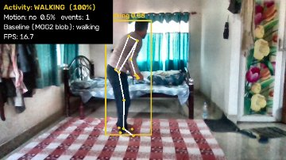 | _segments/gmdcsa-s3__adl-04.mp4 [2.4-3.6s] | standing | walking | Transition / short segment | pose 100%, legs 100%, 202 px tall, camera 0 px/s, 1.2 s | room, static camera; Day; Full T-shirt & Trousers; Picking a |
| T009 | 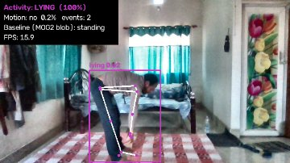 | _segments/gmdcsa-s3__adl-05.mp4 [0-5s] | standing | walking | Limb motion in place read as walking | pose 100%, legs 100%, 239 px tall, camera 0 px/s, 5.0 s | room, static camera; Day; Full T-shirt & Trousers; Exercisin |
| T018 | 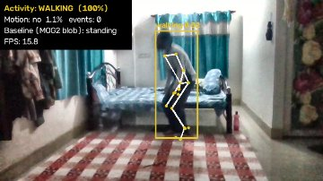 | _segments/gmdcsa-s3__adl-12.mp4 [8.1-9.2s] | standing | walking | Transition / short segment | pose 100%, legs 100%, 160 px tall, camera 0 px/s, 1.1 s | room, static camera; Night; Full T-shirt 2 & Trousers; Chang |
| T047 | 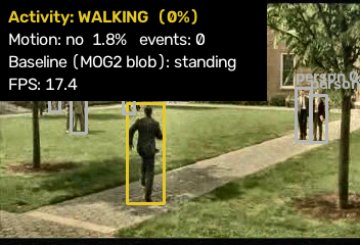 | running/hmdb-a-beautiful-mind-4__01.avi | running | standing | Person not found | pose 39%, legs 100%, 110 px tall, camera 5 px/s, 3.5 s | movie; moving camera; back view; med quality |
| T048 | 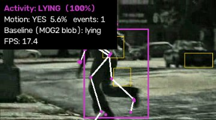 | running/hmdb-americangangster__01.avi | running | lying | Moving camera | pose 88%, legs 100%, 146 px tall, camera 210 px/s, 1.6 s | movie; moving camera; left view; med quality |
| T054 | 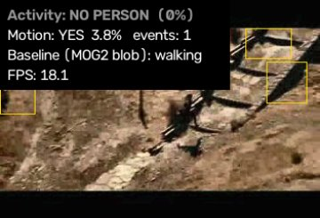 | running/hmdb-return-of-the-king-4__01.avi | running | no person | Person not found | pose 1%, legs 0%, 214 px tall, camera 105 px/s, 4.0 s | movie; moving camera; right view; med quality |
| T055 | 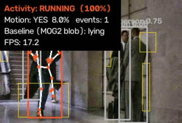 | running/hmdb-the-fugitive-5__01.avi | running | walking | Moving camera | pose 100%, legs 73%, 135 px tall, camera 86 px/s, 2.8 s | movie; moving camera; front view; med quality |
| T056 | 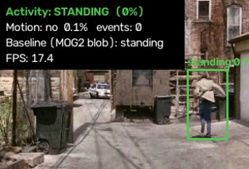 | running/hmdb-the-fugitive-5__02.avi | running | standing | Person not found | pose 22%, legs 100%, 79 px tall, camera 14 px/s, 2.4 s | movie; static camera; back view; med quality |
| T057 | 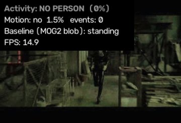 | running/hmdb-the-matrix-1__01.avi | running | sitting | Person not found | pose 2%, legs 100%, 57 px tall, camera 16 px/s, 1.7 s | movie; moving camera; front view; med quality |
| T060 | 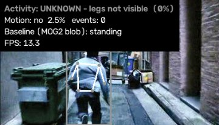 | running/hmdb-the-protector__01.avi | running | walking | Cut off by the frame | pose 78%, legs 28%, 129 px tall, camera 3 px/s, 0.8 s | movie; moving camera; back view; med quality |
| T061 | 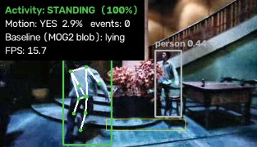 | running/hmdb-the-protector__02.avi | running | walking | Moving camera | pose 60%, legs 90%, 104 px tall, camera 2 px/s, 1.7 s | movie; moving camera; back view; med quality |
| T063 | 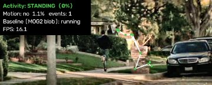 | running/hmdb-veoh-alpha-dog-1__01.avi | running | sitting | Moving camera | pose 54%, legs 83%, 100 px tall, camera 67 px/s, 3.3 s | movie; moving camera; back view; med quality |
| T071 | 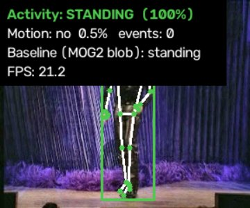 | walking/hmdb-eddieizzardcircle__01.avi | walking | standing | Speed near a threshold | pose 100%, legs 100%, 134 px tall, camera 0 px/s, 2.5 s | movie; static camera; left view; med quality |
| T073 | 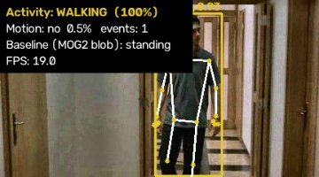 | walking/hmdb-eurotrip__02.avi | walking | standing | Speed near a threshold | pose 97%, legs 65%, 210 px tall, camera 7 px/s, 3.5 s | movie; static camera; front view; med quality |
| T076 | 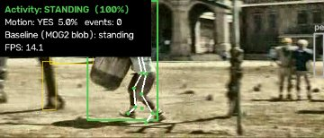 | walking/hmdb-longestyard__03.avi | walking | standing | Speed near a threshold | pose 100%, legs 79%, 122 px tall, camera 5 px/s, 3.6 s | movie; static camera; front view; med quality |
| T078 | 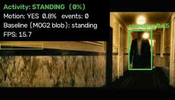 | walking/hmdb-oceans12__02.avi | walking | standing | Moving camera | pose 61%, legs 52%, 116 px tall, camera 0 px/s, 3.3 s | movie; moving camera; front view; med quality |
| T079 | 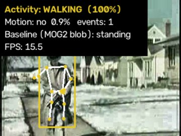 | walking/hmdb-sellingasacareer__01.avi | walking | standing | Speed near a threshold | pose 58%, legs 56%, 148 px tall, camera 0 px/s, 6.8 s | movie; static camera; front view; med quality |
| T080 | 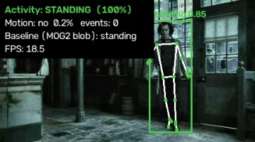 | walking/hmdb-sweeneytodd__01.avi | walking | standing | Moving camera | pose 100%, legs 100%, 129 px tall, camera 16 px/s, 1.8 s | movie; moving camera; front view; med quality |
| T084 | 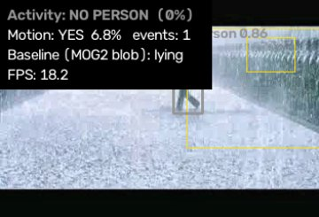 | walking/hmdb-the-matrix-revolutions-5__01.avi | walking | no person | Person not found | pose 1%, legs 100%, 41 px tall, camera 53 px/s, 5.5 s | movie; static camera; left view; med quality |
| T086 |  | walking/hmdb-the-protector__02.avi | walking | standing | Moving camera | pose 94%, legs 79%, 122 px tall, camera 2 px/s, 4.7 s | movie; moving camera; front view; med quality |
| T087 | 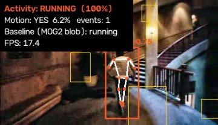 | walking/hmdb-the-protector__03.avi | walking | running | Moving camera | pose 96%, legs 100%, 112 px tall, camera 105 px/s, 1.6 s | movie; moving camera; right view; med quality |
| T089 | 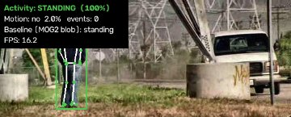 | walking/hmdb-veoh-alpha-dog-1__02.avi | walking | standing | Speed near a threshold | pose 98%, legs 80%, 133 px tall, camera 22 px/s, 2.2 s | movie; static camera; back view; med quality |

<!-- GALLERY END -->
