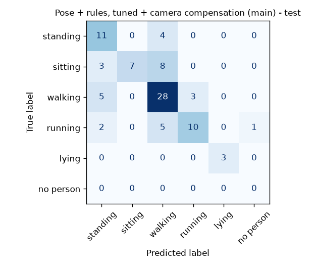

# Milestone 3: Core Implementation and Testing

**Project:** Real-Time and Video-Based Motion Detection and Activity Monitoring System<br>
**Team:** Alabat Cindy I · Porcopio Zheniel Ivan · Veridiano Wilmark — CSST 106, Jeremy C. Reyes<br>
**Repository:** https://github.com/Wilul1/Computer_Vision (tag `cp3-core`) · **Date:** November 12, 2026

## 1. One pipeline, one command

```
python src/run.py --input data/test/ --output outputs/run_2026-11-12/
python src/run.py --input demo.mp4 --output outputs/demo_annotated.mp4
python src/run.py --webcam 0
```

`src/pipeline.py` has four stages, each testable on its own:

| Stage | Input → output | Code |
|---|---|---|
| `preprocess()` | BGR frame → resized (long side ≤ 640) + CLAHE colour image, RGB copy, blurred gray | `src/preprocess.py` |
| `infer()` | → MOG2 foreground blobs, YOLO11n person boxes, 33 MediaPipe landmarks, camera shift (LK optical flow on background points) | `motion.py`, `detector.py`, `pose.py`, `camera_motion.py` |
| `postprocess()` | → angles, thigh ratio, torso tilt, hip speed (minus camera motion), leg swing → rules → majority vote + persistence → label, for **both** the main method and the baseline | `features.py`, `classifier.py` |
| `render()` | → annotated frame (boxes, skeleton, label, baseline label, FPS) + one CSV row | `visualize.py` |

The same `preprocess()` is used by `run.py`, `evaluate.py` and `tune.py`. Nothing is trained: YOLO and MediaPipe
are pretrained, and the rule thresholds are **parameters** (`src/params.py`) tuned on the **val** split by
`scripts/tune.py` (random search, 1500 trials per method, macro-F1), saved in `configs/tuned_params.json`.

## 2. Test set (held out, used once)

**90 labelled segments** from 82 videos, split by source, so no subject or movie in test appears in val or train:

- **45 from GMDCSA24 subject 3:** a room with a fixed camera, **15 at night**. Sitting 18, standing 15, walking 9,
  lying 3.
- **45 from HMDB51:** movie clips (27 walking, 18 running), **32 with a moving camera**, low resolution.

Hard cases are in on purpose: night, moving cameras, people seated while moving their arms, short transitions,
small people.

## 3. Results on the test set

Reproduce with `python src/evaluate.py --split test`. All three methods are scored on the same frames.

| Method | Accuracy | Macro-F1 |
|---|---:|---:|
| Baseline: MOG2 blob shape + speed, tuned on val | 0.200 | 0.095 |
| Pose + rules, Milestone 2 hand-set values | 0.600 | 0.623 |
| **Main: pose + rules, tuned on val, camera compensation** | **0.656** | **0.702** |

| Class (main) | Precision | Recall | F1 | Segments |
|---|---:|---:|---:|---:|
| standing | 0.524 | 0.733 | 0.611 | 15 |
| sitting | 1.000 | **0.389** | 0.560 | 18 |
| walking | 0.622 | 0.778 | 0.691 | 36 |
| running | 0.769 | 0.556 | 0.645 | 18 |
| lying | 1.000 | 1.000 | 1.000 | 3 |

**Speed:** 58.8 ms per frame = **17.0 FPS**, on an Intel Core i7-6700HQ laptop CPU (Windows 10, no GPU), with YOLO on.
This is the median over 8,875 frames after a 30-frame warm-up per clip, excluding video decoding. Per stage:
preprocess 9.0 ms, infer 48.3 ms, postprocess 0.6 ms, render 0.6 ms.

**How to read these numbers honestly:**

- The main method beats the baseline by a wide margin. Shape and motion of a foreground blob cannot tell sitting
  from standing, and a still person fades into the MOG2 background.
- Against the Milestone 2 values the gain is smaller than it looks. Lying went from 0.75 to 1.00 F1 on **only 3
  segments**. Without lying, macro-F1 is **0.627 vs 0.591**.
- Tuning **traded sitting for walking**: sitting F1 fell from 0.718 to 0.560. On the room clips the tuned version
  is worse (29 vs 36 of 45 correct). On the movie clips it is much better (30 vs 18 of 45). The cause is analysed
  in section 4.



## 4. Error analysis (31 failures)

| Cause | Count | Example |
|---|---:|---|
| **Limb motion in place read as walking** | **11** | T024: seated, talking. Hip speed 0.01, but leg swing 0.40 > 0.354 threshold → walking |
| Moving camera | 6 | T055: chase scene, camera pans 79 px/s |
| Transition / short segment | 3 | T018: 1.1 s of standing between sitting and walking |
| Speed near a threshold | 3 | T071: slow walk called standing |
| Person not found | 3 | T084: tiny person in rain; T054: dark and blurred |
| Look-alike posture | 2 | T041/T042: sitting on the bed edge, front view, thighs pointing down |
| Cut off by the frame | 2 | T060: legs behind a bin |
| Far away / low resolution | 1 | T056: runner 79 px tall |

Night segments scored 7 of 15 against 22 of 30 in daylight, but **darkness was not the cause**: the pose was found
in 70–100% of their frames, and the failures are the causes above. The full gallery, with one frame per failure and
its measured signals, is in `docs/error_analysis.md`.

## 5. Improvement plan

| Failure cause (count) | Change | Expected effect / how measured |
|---|---|---|
| Limb motion in place read as walking (11) | Check the seated posture before speed. Walking by leg swing needs the two ankles moving in **opposite directions**. Tune with each dataset weighted equally, with more sitting in val. | Sitting recall 0.39 → ≥ 0.7. Room-clip accuracy back to ≥ 36/45 while keeping the movie gain. Per-class and per-dataset recall on val, then test once. |
| Moving camera, pose lost, small person (10) | RANSAC homography instead of median shift for camera motion. Pose on the upscaled YOLO crop when the person is < 120 px. | Pose found ≥ 90% on HMDB clips. Running recall 0.56 → ≥ 0.7. |
| Transitions and speed boundaries (6) | Skip 0.5 s around label changes when scoring. Add stride frequency to separate walking from running. | Transition errors → 0. Walking/running confusion halved on val. |

Also needed: more **lying** data (3 val, 3 test segments), and our own webcam recordings.

## 6. Deliverables in the repository

`src/run.py` · `src/evaluate.py` · `scripts/tune.py` · `configs/tuned_params.json` · `scripts/failure_gallery.py` ·
`docs/results_test.md` (full test log) · `docs/error_analysis.md` (gallery + plan) · `docs/design_choices.md` ·
`data/README.md` (data card) · `outputs/metrics/` (JSON + CSV logs).
