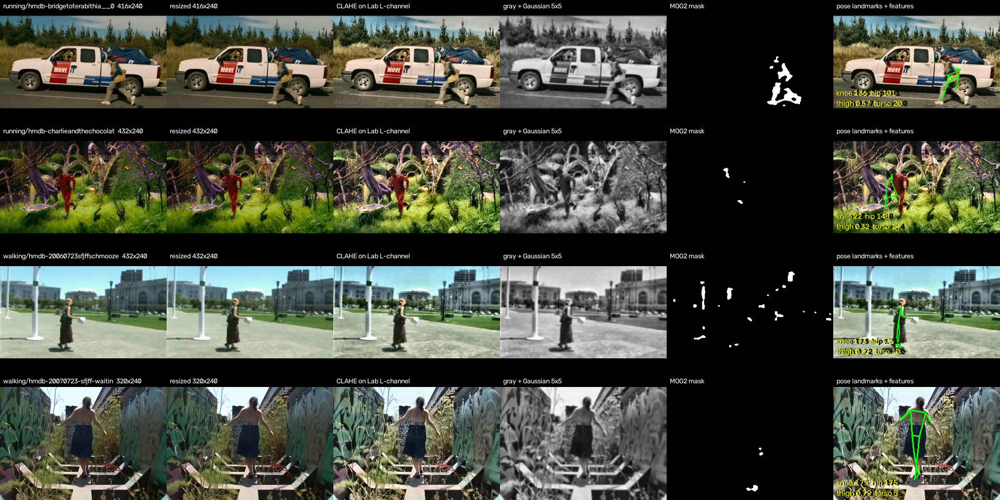

# Milestone 2: 50% Progress Report

**Project:** Real-Time and Video-Based Motion Detection and Activity Monitoring System 
**Team:** Alabat Cindy I · Porcopio Zheniel Ivan · Veridiano Wilmark — CSST 106, Jeremy C. Reyes 
**Repository:** https://github.com/Wilul1/Computer_Vision (tag `cp2-50`) · **Date:** October 29, 2026

## 1. Task status

| Task (from proposal) | Owner | Status | Evidence |
|---|---|---|---|
| Python environment, pinned requirements, README setup | Wilmark | Done | `requirements.txt`, `README.md` (tested on a fresh copy) |
| Webcam / video / image input module | Wilmark | Done | `src/predict.py`: one command for a file or camera index |
| Preprocessing: resize, CLAHE, blur | Cindy | Done | `src/preprocess.py`, `docs/figures/preprocessing.jpg` |
| Motion baseline: MOG2 + contours, event counter | Cindy | Code done, count pending | `src/motion.py`, `scripts/eval_motion_baseline.py` |
| Person detection: pretrained YOLO11n | Zheniel | Done | `src/detector.py` |
| Pose estimation: MediaPipe, 33 landmarks | Zheniel | Done | `src/pose.py` |
| Features: joint angles, thigh ratio, torso tilt, speeds | Wilmark | Done | `src/features.py` |
| Rule-based classifier + temporal smoothing | Wilmark | First version | `src/classifier.py`, thresholds in `src/config.py` |
| Overlay UI: boxes, skeleton, label, FPS | Cindy | Done | `src/visualize.py` |
| Public dataset: import, split by source, data card | Zheniel | Done (walking, running) | `scripts/import_public.py`, `data/splits.csv`, `data/README.md` |
| Own recordings: sitting, standing, lying | All | In progress | `scripts/record_clips.py` |
| Evaluation scripts + val numbers | Wilmark | Done | `scripts/run_all_eval.py`, `outputs/metrics/activity_val.json` |
| Design justification | All | Done | `docs/design_choices.md` |
| Threshold tuning, camera-motion fix, fall detection, lighting tests | All | Not started (Phase 3–4) | |

## 2. Dataset

**294 clips** from **HMDB51** (walk and run classes), restricted to full-body, single-person, non-bad-quality
clips with at most 3 clips per movie. The split is **by source movie** (119 movies), so no movie appears in two
splits. The test split is locked in `data/splits.csv` and was not used for anything in this report.

| Split | Walking | Running | Clips | Source movies |
|---|---:|---:|---:|---:|
| train | 127 | 78 | 205 | 79 |
| val | 32 | 12 | 44 | 20 |
| test | 27 | 18 | 45 | 20 |

All clips are 240 px tall and 30 fps, with a median length of 2.7 s (15 minutes in total). The sitting,
standing and lying classes come from our own webcam and phone recordings, which are in progress. HMDB51's
"sit" and "stand" classes are the *motions* of sitting down and standing up, not postures, so we did not use them.

## 3. Preprocessing

Columns: original → resized (long side ≤ 640) → CLAHE on the Lab L-channel → grayscale + 5×5 Gaussian (MOG2
input) → MOG2 mask → pose landmarks with the extracted features. Rows 3–4 show that **MOG2 produces scattered
noise when the camera moves**, as it does in most movie clips. Background subtraction assumes a fixed camera.
The reasons for each setting are in `docs/design_choices.md`.

## 4. Baseline numbers (validation split)

Reproduce with `python scripts/eval_activity.py --split val`, or `python scripts/run_all_eval.py`.

| Method | Metric | Value |
|---|---|---|
| Pose + rules (main method) | Clip-level accuracy, 44 val clips | **0.477** |
| Pose + rules (main method) | Macro-F1 (walking, running) | **0.510** |
| Full pipeline (YOLO + pose + MOG2 + rules) | Processing speed, laptop CPU (i7-6700HQ), 240p clips | **11.8 FPS** (7–9 FPS on 640×480 webcam) |
| MOG2 + contours (motion baseline) | Motion events vs hand count | Pending (see below) |

**Confusion matrix** (rows = true, columns = predicted):

| true \ predicted | walking | running | standing | sitting | no person |
|---|---:|---:|---:|---:|---:|
| walking (32) | **18** | 2 | 11 | 0 | 1 |
| running (12) | 4 | **3** | 3 | 2 | 0 |

**What the errors tell us** (first look; full error analysis comes in Phase 3):

1. **Walking → standing (11 clips).** In movies the camera usually *follows* the actor, so the person stays in the
   same place in the frame. Our hip speed is measured relative to the frame, so it is close to zero. Planned fix:
   measure speed relative to the background (optical flow on background points), and rely more on leg swing.
2. **Running → walking or standing (7 clips).** This has the same camera-following cause, plus short clips
   (median 2.7 s) where the 9-frame smoothing and 0.5 s speed window use up a large part of the clip.
3. **Running → sitting (2 clips).** During a running stride the knee bends below 130°. When the speed is
   underestimated (cause 1), this matches the sitting rule. Planned fix: require the bent posture to last at
   least 1 s before calling it sitting.

**Motion baseline count:** the hand-count comparison needs a **fixed camera**. On HMDB's moving-camera clips the
MOG2 mask is mostly background noise (figure rows 3–4), so a count there would not be meaningful. It will be
measured on 3 static-camera recordings of our own, as soon as they are recorded.

## 5. Percent complete

| Work package (whole project) | Weight | Done |
|---|---:|---:|
| Environment, input module | 5 | 5 |
| Preprocessing | 5 | 5 |
| MOG2 motion baseline (code + count) | 5 | 4 |
| YOLO + pose integration | 10 | 10 |
| Features + rule classifier (first version) | 15 | 12 |
| Overlay UI | 5 | 5 |
| Dataset (public + own recordings) | 10 | 5 |
| Evaluation scripts + val numbers | 10 | 9 |
| Threshold tuning + camera-motion fix | 15 | 0 |
| Fall detection | 5 | 0 |
| Lighting tests + final test-split evaluation | 5 | 0 |
| Documentation, presentation, demo | 10 | 3 |
| **Total** | **100** | **58** |

**58% complete.** The weights are our estimate of effort. "Done" counts only work that runs and is in the
repository.

## 6. Blockers

- **Own recordings** for sitting, standing and lying, and static-camera clips for the motion count. Each member
  records 2 sessions in different rooms and lighting.
- **Moving cameras in public data** make frame-relative speed unreliable (error causes 1–2 above).

## 7. Next dates

- **Oct 31 – Nov 1:** own recordings done, added to the split as new sources (the existing test split does not
  change), motion hand count measured.
- **Nov 2 – Nov 12 (80% check):** tune thresholds on val, add camera-motion compensation, minimum-duration rule
  for sitting, fall detection, tests in different lighting.
- **Nov 13–20:** final evaluation on the locked test split, presentation and live demo.

## 8. Correction to the proposal timeline

Weeks 3–5 of the proposal mention squats, push-ups, lunges, jumping jacks and repetition counting. Those were
carried over by mistake. The project classifies standing, sitting, walking, running and lying, as stated in the
objectives.
