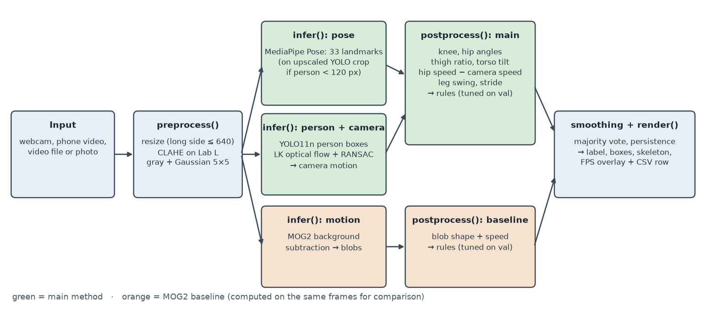
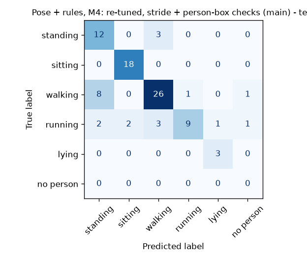

# Real-Time and Video-Based Motion Detection and Activity Monitoring System Using Computer Vision

**Report draft (Milestone 4, 80% check).** 
Alabat Cindy I · Porcopio Zheniel Ivan · Veridiano Wilmark — CSST 106 Computer Vision, Jeremy C. Reyes 
Laguna State Polytechnic University · Repository: https://github.com/Wilul1/Computer_Vision (tag `cp4-80`)

## 1. Introduction and problem

Watching people for safety, security or behaviour analysis is still mostly done by hand. A person watching a live
feed gets tired and misses events, and reviewing recorded footage is slow. Automatic motion detectors exist, but
they usually need special hardware (thermal sensors, CCTV networks), and they only say *that* something moved. A
passing shadow or a pet triggers them as easily as a person, and they cannot say what the person is doing.

This project builds a system that uses an ordinary laptop webcam, phone camera or recorded video, finds the
person, and says **what they are doing: standing, sitting, walking, running or lying**. It does this live and on
recorded video, on a laptop CPU.

## 2. Objectives

**General:** design, build and evaluate a real-time and video-based motion detection and activity monitoring
system that uses standard device cameras.

**Specific:**
1. A video module that accepts live camera feeds and recorded video files (and photos). *Done: `src/run.py`, `app.py`.*
2. A computer-vision method that detects people and tracks their motion (OpenCV, MediaPipe, YOLO). *Done.*
3. Classification of standing, sitting, walking, running and lying from the tracked motion. *Done. Sudden
   abnormal movement (falls) is still open; see `docs/remaining.md`.*
4. An interface that shows the footage with boxes and activity labels. *Done: the Gradio app and the OpenCV window.*
5. Evaluation of accuracy, speed (FPS) and reliability in different lighting. *Done for public footage; our own
   webcam footage is still to be recorded.*

## 3. Dataset

| | GMDCSA24 | HMDB51 |
|---|---|---|
| What | One room, **fixed camera**, 4 people, day / night / lights off, 1280×720 | Movie and web clips, **often a moving camera**, 240 px tall |
| Classes used | sitting, standing, walking, lying (from the authors' time-segment labels) | walk, run |
| Licence | MIT | Non-commercial research |
| Split unit (source) | Subject | Movie |

The split is by **source**, so a person or movie never appears in two splits. GMDCSA24 has 4 subjects: 2 in train,
1 in val, and 1 in test. For test we chose a subject filmed in both day and night, **before** computing any result
on them. Ground truth is a list of labelled **segments**: a GMDCSA24 video contains several activities with time
ranges, and each range of at least 1 s is scored separately. Counts: train 280, val 108, test 90 segments. The
full data card is in `data/README.md`.

Nothing is trained (see §4), so train is a reserve. The rule thresholds are tuned on **val**, and **test** is only
used for reporting.

## 4. Methodology

The pipeline (`src/pipeline.py`) has four stages:

1. **preprocess()** resizes the frame so its long side is at most 640 px (YOLO's training size, ≈5× fewer pixels
   than 1080p). It applies **CLAHE** on the L channel of Lab, which raises local contrast in dark rooms without
   shifting colours. It also makes a grayscale, Gaussian-blurred copy for background subtraction and optical flow.
2. **infer()**
   - **YOLO11n** (pretrained on COCO) finds people. The largest box is the person being monitored.
   - **MediaPipe Pose** finds 33 body landmarks. If the person is shorter than 120 px or is missed, it runs on the
     YOLO crop upscaled to 256 px.
   - **Camera motion**: Lucas–Kanade optical flow on background corners (the person is masked out), with a
     shift/rotation/zoom model fitted by **RANSAC**.
   - **MOG2** background subtraction, used only by the baseline.
3. **postprocess()** turns the landmarks into scale-free features:
   - knee and hip angles;
   - the thigh ratio (vertical hip-to-knee drop ÷ torso length), which catches sitting seen from the front;
   - torso tilt;
   - hip speed minus camera speed, in body-heights per second;
   - leg swing (range of ankle positions relative to the hips);
   - stride (how much the gap between the ankles changes).

   Ordered **rules** map the features to a label: hips not visible → unknown; torso tilted → lying; folded leg
   while the hips stay still → sitting; then running, walking or standing by speed. A **majority vote** over
   recent frames and a **persistence** rule remove flicker.
4. **render()** draws the boxes, skeleton, label, the baseline's label and FPS, and writes one CSV row per frame.

**Baseline.** To measure what pose adds, a baseline uses **only the MOG2 foreground**. It takes the shape
(height/width) and speed of the largest moving blob and applies the same kind of rules. It runs on the same
frames.

**Why rules and not a trained classifier?** We have segment labels, not frame labels, and a few hundred segments.
Rules on physical quantities (degrees, body-heights per second) can be checked frame by frame and explained.
13 thresholds tuned on val overfit far less than training a classifier would.

**Tuning.** `scripts/tune.py` uses random search (1500 trials per method, seed 106) on **val only**. Each trial
replays cached features through the rules, so the networks are not re-run. Since Milestone 4, the objective is
the **mean of the macro-F1 on each dataset**, so room footage and movie clips count equally (see §6).

**Application.** `app.py` is a Gradio browser app with three tabs: Video, Photo and Webcam. It shows the
annotated output, the main activity, its confidence, the time per activity, a timeline, motion events and
milliseconds per frame. The models are loaded once at start-up.

## 5. Experiments and results so far

Every number below is printed by `python src/evaluate.py --split test` from the `cp4-80` tag. It works without
the videos, from the committed per-frame features. All methods are scored on the same 90 held-out test segments:
sitting 18, standing 15, walking 36, running 18, lying 3. The main metric is **macro-F1**, because the classes are
imbalanced (lying has 3 segments, walking 36).

| Method | Accuracy | Macro-F1 |
|---|---:|---:|
| Baseline: MOG2 blob + rules | 0.178 | 0.081 |
| Pose + rules, Milestone 2 hand-set values | 0.622 | 0.651 |
| Pose + rules, Milestone 3 tuned values | 0.633 | 0.657 |
| **Pose + rules, Milestone 4 (main)** | **0.756** | **0.772** |

| Class (main) | Precision | Recall | F1 |
|---|---:|---:|---:|
| standing | 0.545 | 0.800 | 0.649 |
| sitting | 0.900 | 1.000 | 0.947 |
| walking | 0.812 | 0.722 | 0.765 |
| running | 0.900 | 0.500 | 0.643 |
| lying | 0.750 | 1.000 | 0.857 |

**By condition:** a fixed room camera scores **93%** in both day and night (42 of 45), while movie clips score
58% (26 of 45). People at least 150 px tall score 88%, and people under 90 px score 57%. The full table is in
`docs/results_test.md`.

**Speed** on the demo laptop (Intel Core i7-6700HQ, no GPU, YOLO on): **66 ms per frame = 15.1 FPS**. This is the
median after a 30-frame warm-up per clip. Most of the time is spent in YOLO and MediaPipe inference. **Model
sizes:** YOLO11n 5.6 MB and MediaPipe pose lite 5.8 MB, both pretrained, with nothing trained by us.

**Test cases:** 9 of 13 file-based cases pass, including 3 of the 4 Milestone 3 failures that were turned into test
cases (TC05–TC07 pass, TC08 still fails; see `docs/test_cases.md`). The 2 webcam cases are run live.

## 6. Change since checkpoint 3, and what caused it

Milestone 3's error analysis found that 11 of 31 test failures were *limb motion in place read as walking*, and
that tuning on the overall macro-F1 traded room accuracy for movie accuracy. Milestone 4 made four changes. Their
effect was measured on **val**, one change at a time (balanced macro-F1 = the mean over the two datasets):

| Change | Effect on val |
|---|---|
| Re-tuning, with each dataset weighted equally and the new options available | 0.595 → 0.637 |
| Camera motion fitted by RANSAC (was a median shift) | +0.026 |
| A pose only counts if YOLO also sees a person | +0.024 (0.637 → 0.661) |
| Stride check (the ankles must move in opposite directions) | no measurable effect on val (+0.06 on test) |

On test, sitting recall rose from 0.39 to 1.00, and the room footage from 29 to 42 of 45 correct. The movie clips
stayed about the same (28 → 26 of 45).

**Honest caveats.** The changes were designed from test failures, so the test gain over the M3 parameters
(+0.115) is likely optimistic; the val gain (+0.066) is the safer estimate. Random search over about 20
parameters with about 100 val segments is noisy: a second search scored 0.650 on val but much lower on test, and it
was rejected by its val score. The person-box check removes false skeletons (test case TC13) but also hides people
YOLO misses: lying on the floor (TC04) and near-darkness (TC09).

## 7. Limitations and operating conditions

Designed for: a **fixed camera**, the **whole body in view** (≥ 150 px tall, about 2–5 m from a laptop camera),
one main person, room light, and activities lasting at least ~1.5 s. Not reliable for: hand-held or panning
footage, people under ~100 px, near-darkness, fast transitions, or bending and arm exercises while standing.
Details, with an example and a cause for each, are in `docs/limitations.md`.

## 8. Remaining work

See `docs/remaining.md`: our own webcam recordings and their evaluation, more lying data, fall detection, the final
report and slides, and the frozen final evaluation.
